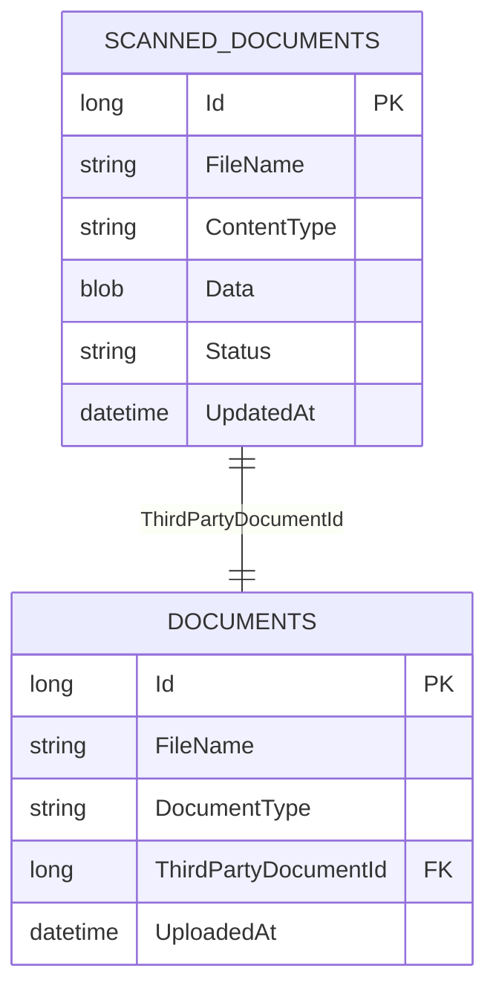
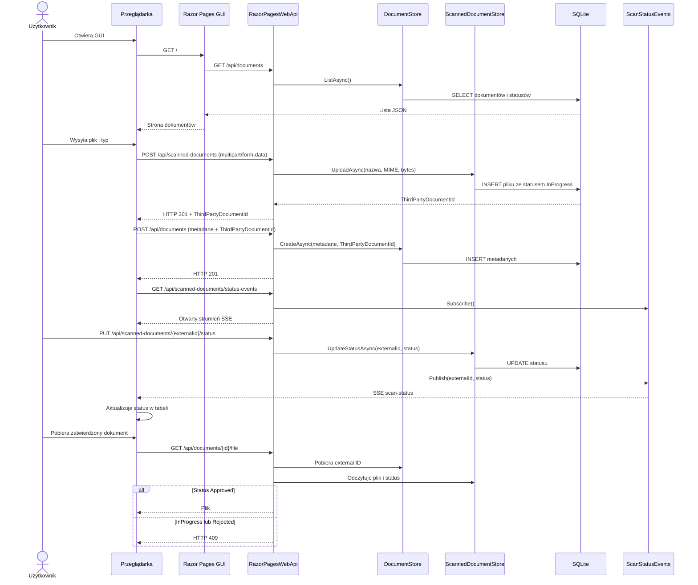

# Architektura GUI i API

Rozwiązanie składa się z dwóch niezależnych projektów:

- `RazorPagesWebApp` renderuje GUI i komunikuje się z backendem przez HTTP.
- `RazorPagesWebApi` udostępnia REST API, obsługuje skanowanie i przechowuje dane w SQLite.

Frontend nie ma referencji do projektu backendu ani pakietów bazodanowych. Adres API ustawia `BackendApi:BaseUrl` w konfiguracji GUI. Backend ogranicza CORS do originów z `Cors:AllowedOrigins`.

Lokalnie uruchom oba projekty: GUI pod `http://localhost:5238`, API pod `http://localhost:5280`. W Riderze można ustawić oba projekty jako projekty startowe rozwiązania. Jeśli zmienisz host lub port GUI, dodaj jego origin do `Cors:AllowedOrigins`; jeśli zmienisz adres API, ustaw `BackendApi:BaseUrl` w konfiguracji GUI. Dla profilu HTTPS GUI ma nadpisanie `BackendApi__BaseUrl=https://localhost:7280`.

## Model danych

Tabela `ScannedDocuments` symuluje zewnętrzny skaner: przechowuje plik jako BLOB, nazwę, typ MIME i status. Tabela `Documents` przechowuje metadane biznesowe i `ThirdPartyDocumentId` — identyfikator rekordu po stronie skanera.

Statusy to `InProgress`, `Approved` i `Rejected`.

## Diagram sekwencji

## Endpointy

- `GET /api/documents` — lista dokumentów i statusów.
- `POST /api/scanned-documents` — upload pliku do symulowanego skanera; odpowiedź zawiera nowe `thirdPartyDocumentId`.
- `GET /api/scanned-documents/{thirdPartyDocumentId}` — metadane i status pliku u skanera.
- `GET /api/scanned-documents/{thirdPartyDocumentId}/file` — plik tylko po statusie `Approved`.
- `PUT /api/scanned-documents/{thirdPartyDocumentId}/status` — aktualizacja statusu.
- `POST /api/documents` — zapis metadanych GUI wraz z zewnętrznym ID.
- `GET /api/documents/{id}` — szczegóły lokalnego dokumentu.
- `GET /api/documents/{id}/file` — pobranie przez lokalne ID; backend sprawdza status u skanera.
- `GET /api/scanned-documents/status-events` — strumień Server-Sent Events dla GUI.

Formularz GUI wysyła plik i metadane bezpośrednio do REST API przez `fetch`. Adres backendu jest konfigurowalny; dla CORS trzeba dodać origin GUI do `Cors:AllowedOrigins` po stronie backendu.

GUI uruchamia SSE przez współdzielony `ScanStatusEventsViewComponent` w `RazorPagesWebApp`. Dowolna strona Razor może dodać `@await Component.InvokeAsync("ScanStatusEvents")`; wspólny `scan-status-events.js` otworzy jedno połączenie na adres API i wyemituje zdarzenie DOM `scan-status-changed`. Tabela może opcjonalnie oznaczyć wiersz `data-third-party-document-id`, komórkę `.scan-status` i komórkę akcji `.scan-status-action`, aby skrypt aktualizował status i przycisk pobierania.

Requesty API są walidowane przez osobne klasy FluentValidation w katalogu `Validation`. Błędy zwracane są jako `ValidationProblemDetails`. Plik `Requests/ScanDocument.http` zawiera przykładowe requesty do Ridera.

## Ograniczenia symulacji

- Backend przechowuje skaner w tej samej bazie SQLite wyłącznie na potrzeby symulacji. Prawdziwa integracja zastąpiłaby `ScannedDocumentStore` klientem HTTP zewnętrznego skanera.
- Zdarzenia SSE są w pamięci pojedynczej instancji; wiele instancji wymaga współdzielonego brokera.
- Endpoint zmiany statusu nie ma uwierzytelniania ani podpisu callbacku.
