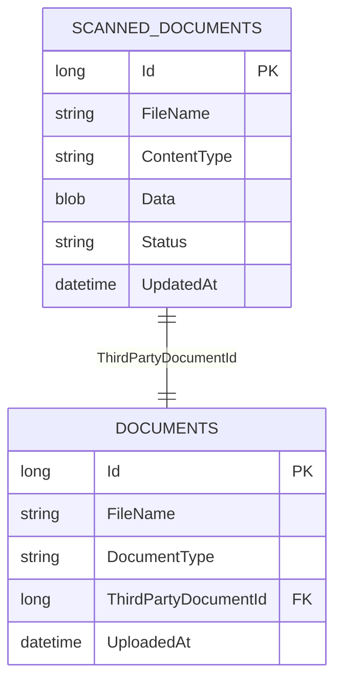
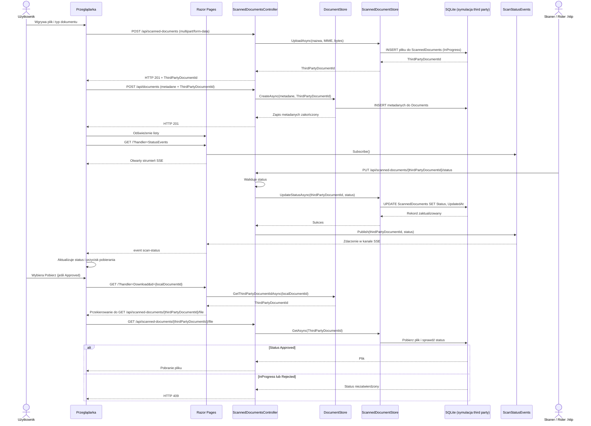

# Przechowywanie i status skanowania dokumentów

## Model danych

W tej symulacji tabela `ScannedDocuments` reprezentuje system third party: zawiera fizyczny plik jako BLOB, nazwę pliku, typ MIME i status skanowania. Nasza tabela `Documents` przechowuje metadane biznesowe, takie jak typ dokumentu, oraz `ThirdPartyDocumentId` — identyfikator pliku w systemie skanera.

Schemat relacji:



Statusy to `InProgress`, `Approved` i `Rejected`. Po wgraniu pliku tworzony jest rekord po stronie skanera ze statusem `InProgress`, a jego ID zostaje zapisane w `Documents.ThirdPartyDocumentId`.

## Diagram sekwencji



## REST API

Formularz używa REST API przez `fetch`; nie wywołuje bezpośrednio serwisu bazodanowego. Najpierw wysyła plik do `POST /api/scanned-documents` jako `multipart/form-data`. API zwraca `201 Created` i nowe `thirdPartyDocumentId`. Następnie przeglądarka rejestruje metadane lokalnie przez `POST /api/documents`, przekazując otrzymane ID.

Skaner wysyła zewnętrzny identyfikator — nie lokalne `Documents.Id` — do `PUT /api/scanned-documents/{thirdPartyDocumentId}/status`:

```http
PUT http://localhost:5238/api/scanned-documents/3/status
Content-Type: application/json

{"status":"Approved"}
```

`GET /api/scanned-documents/{thirdPartyDocumentId}` zwraca zewnętrzny rekord i status. `GET /api/scanned-documents/{thirdPartyDocumentId}/file` pobiera plik wyłącznie po zatwierdzeniu. Lokalny rekord można odczytać przez `GET /api/documents/{id}`.

Requesty API są walidowane przez klasy FluentValidation w katalogu `Validation`. Błędy walidacji zwracane są jako `ValidationProblemDetails`.

Plik `Requests/ScanDocument.http` zawiera przykłady uploadu, rejestracji metadanych, zmiany statusu i pobrania. Po uploadzie ustaw `@thirdPartyDocumentId` na ID z odpowiedzi API.

API przyjmuje tylko trzy wymienione statusy. Nieprawidłowy status zwraca `400`, a nieznany zewnętrzny identyfikator — `404`. Po udanej zmianie status jest publikowany do otwartych stron przez Server-Sent Events (SSE).

## Dostęp do pliku

Widok pokazuje przycisk pobierania tylko dla statusu `Approved`. Handler pobierania odczytuje `ThirdPartyDocumentId` z `Documents` i przekierowuje przeglądarkę do endpointu plikowego. Endpoint zwraca `409`, dopóki plik nie ma statusu `Approved`.

## Inicjalizacja bazy

Przy starcie `DatabaseInitializer` tworzy bazę oraz tabele `ScannedDocuments` i `Documents`, jeśli jeszcze nie istnieją. Aplikacja zakłada świeży schemat i nie próbuje migrować ani odtwarzać danych ze starszego układu tabel.

## Ograniczenia symulacji

- Tabela `ScannedDocuments` i `ScannedDocumentStore` znajdują się w tej samej aplikacji wyłącznie po to, by zasymulować zewnętrzny system. Formularz i przykłady używają granicy REST; w prawdziwej integracji domena skanera wskazywałaby usługę third party.
- Powiadomienia SSE istnieją w pamięci procesu i nie są odtwarzane po rozłączeniu. Po odświeżeniu strony status jest pobierany ponownie z bazy.
- Rozwiązanie SSE działa dla jednej instancji aplikacji. Wiele instancji wymagałoby współdzielonego brokera zdarzeń.
- Endpoint callbacku nie ma uwierzytelniania ani podpisu requestu; jest przeznaczony do lokalnej symulacji.
