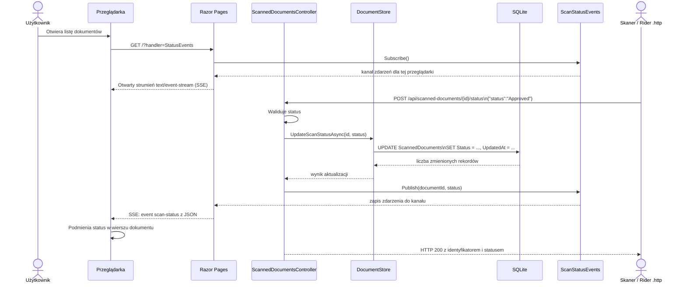

# Aktualizacja statusu skanowania dokumentu

## Przegląd

Aplikacja symuluje integrację z zewnętrznym skanerem antywirusowym. Skaner (lub plik `.http` uruchomiony w Riderze) wysyła do API identyfikator dokumentu i nowy status. API zapisuje status w SQLite, a następnie publikuje zdarzenie do przeglądarek, które mają otwartą listę dokumentów.

Dozwolone statusy:

- `InProgress` — skanowanie trwa; ten status jest ustawiany automatycznie po dodaniu pliku.
- `Approved` — skaner zaakceptował plik.
- `Rejected` — skaner odrzucił plik.

## Diagram sekwencji



## Szczegóły przepływu

1. Lista dokumentów otwiera połączenie `EventSource` pod adresem `/?handler=StatusEvents`. To połączenie pozostaje otwarte i służy wyłącznie do odbierania zdarzeń.
2. Razor Page rejestruje połączenie w singletonie `ScanStatusEvents`. Każda otwarta przeglądarka ma własny kanał zdarzeń.
3. Klient skanera wysyła request do API, na przykład:

   ```http
   POST http://localhost:5238/api/scanned-documents/1/status
   Content-Type: application/json

   {"status":"Approved"}
   ```

4. Kontroler dopuszcza wyłącznie `InProgress`, `Approved` lub `Rejected`. Nieprawidłowy status zwraca `400`, a brak dokumentu lub rekordu skanowania — `404`.
5. `DocumentStore` zapisuje status i czas zmiany w `ScannedDocuments`. Dopiero po udanym zapisie kontroler publikuje zdarzenie.
6. `ScanStatusEvents` przekazuje zdarzenie do aktywnych kanałów. Razor Page serializuje je do formatu SSE, a JavaScript szuka wiersza o pasującym `data-document-id` i podmienia tekst w komórce statusu.
7. Po zamknięciu karty przeglądarka zamyka połączenie. Żądanie zostaje anulowane, a strona usuwa kanał z listy subskrybentów.

## Tabele SQLite

- `Documents` przechowuje plik, nazwę, typ dokumentu, typ MIME i datę dodania.
- `ScannedDocuments` przechowuje status i czas jego ostatniej zmiany. Kolumna `DocumentId` jest kluczem obcym do `Documents.Id` i ma ograniczenie `UNIQUE`, więc w tej wersji jeden dokument ma jeden bieżący rekord statusu.

Wiersze statusu są tworzone razem z dokumentem jako `InProgress`. Zmiana statusu aktualizuje ten rekord — aplikacja nie przechowuje historii kolejnych wyników skanowania.

## Granice obecnej symulacji

- Powiadomienia są przechowywane tylko w pamięci procesu. Zmiany zapisane w SQLite są trwałe, ale zdarzenie wysłane podczas niedostępności przeglądarki nie jest odtwarzane. Po ponownym otwarciu lub odświeżeniu strony status zostanie pobrany z bazy.
- To rozwiązanie działa dla jednej instancji aplikacji. Przy wielu instancjach potrzebny byłby wspólny broker zdarzeń, na przykład Redis lub Azure SignalR.
- Endpoint nie ma uwierzytelniania ani podpisywania callbacków. To przykład do lokalnej symulacji, nie gotowa integracja produkcyjna ze skanerem.
- SSE przesyła aktualizacje z serwera do przeglądarki. Zmianę statusu nadal inicjuje osobny request HTTP do API.
