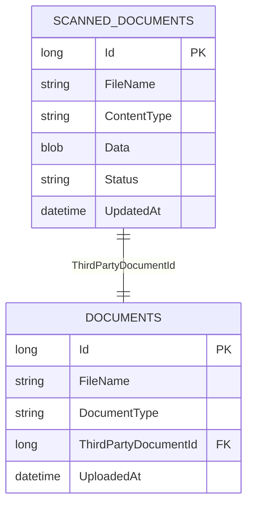
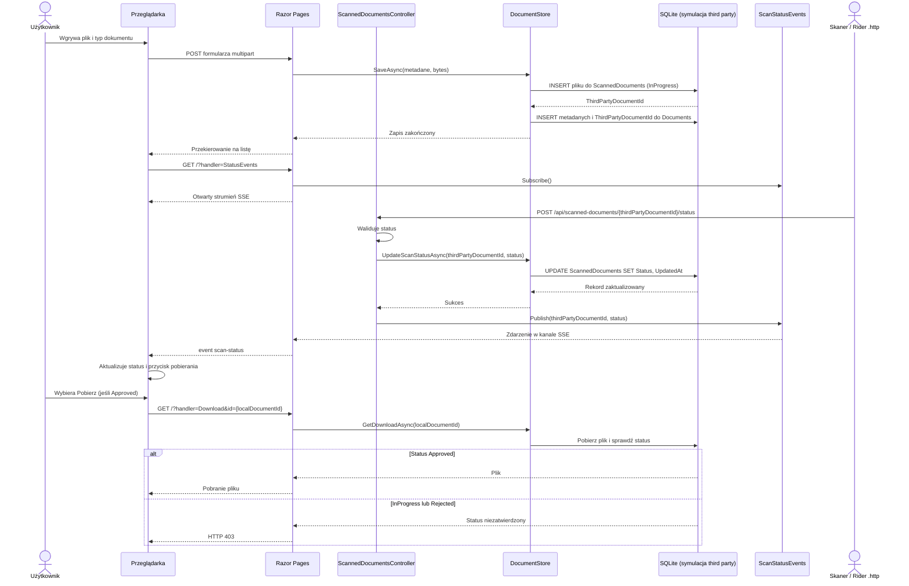

# Przechowywanie i status skanowania dokumentów

## Model danych

W tej symulacji tabela `ScannedDocuments` reprezentuje system third party: zawiera fizyczny plik jako BLOB, nazwę pliku, typ MIME i status skanowania. Nasza tabela `Documents` przechowuje metadane biznesowe, takie jak typ dokumentu, oraz `ThirdPartyDocumentId` — identyfikator pliku w systemie skanera.

Schemat relacji:



Statusy to `InProgress`, `Approved` i `Rejected`. Po wgraniu pliku tworzony jest rekord po stronie skanera ze statusem `InProgress`, a jego ID zostaje zapisane w `Documents.ThirdPartyDocumentId`.

## Diagram sekwencji



## Endpoint zmiany statusu

Skaner wysyła zewnętrzny identyfikator — nie lokalne `Documents.Id`:

```http
POST http://localhost:5238/api/scanned-documents/3/status
Content-Type: application/json

{"status":"Approved"}
```

Plik `Requests/ScanDocument.http` zawiera przykłady requestów do Ridera. Wartość zmiennej `@thirdPartyDocumentId` musi wskazywać `Documents.ThirdPartyDocumentId`.

API przyjmuje tylko trzy wymienione statusy. Nieprawidłowy status zwraca `400`, a nieznany zewnętrzny identyfikator — `404`. Po udanej zmianie status jest publikowany do otwartych stron przez Server-Sent Events (SSE).

## Dostęp do pliku

Widok pokazuje przycisk pobierania tylko dla statusu `Approved`. Handler pobierania ponownie sprawdza status w bazie, więc ręczne wywołanie URL dla pliku `InProgress` lub `Rejected` zwraca `403`. Plik jest odczytywany z `ScannedDocuments`, a nie z tabeli `Documents`.

## Inicjalizacja bazy

Przy starcie `DatabaseInitializer` tworzy bazę oraz tabele `ScannedDocuments` i `Documents`, jeśli jeszcze nie istnieją. Aplikacja zakłada świeży schemat i nie próbuje migrować ani odtwarzać danych ze starszego układu tabel.

## Ograniczenia symulacji

- Tabela `ScannedDocuments` znajduje się w tej samej bazie SQLite, tylko po to, by zasymulować zewnętrzny system. W rzeczywistej integracji `DocumentStore` wywoływałby API third party, a plik nie byłby lokalnym BLOB-em.
- Powiadomienia SSE istnieją w pamięci procesu i nie są odtwarzane po rozłączeniu. Po odświeżeniu strony status jest pobierany ponownie z bazy.
- Rozwiązanie SSE działa dla jednej instancji aplikacji. Wiele instancji wymagałoby współdzielonego brokera zdarzeń.
- Endpoint callbacku nie ma uwierzytelniania ani podpisu requestu; jest przeznaczony do lokalnej symulacji.
